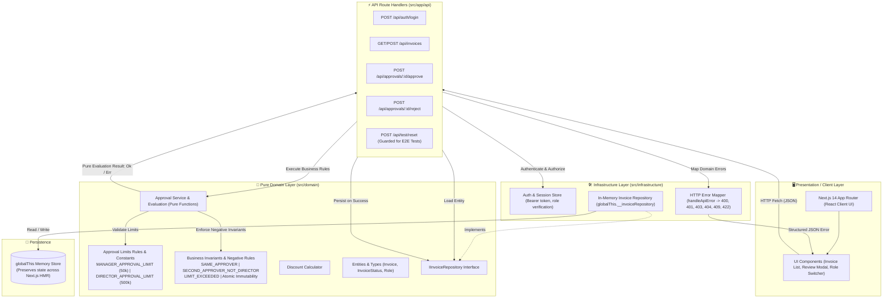
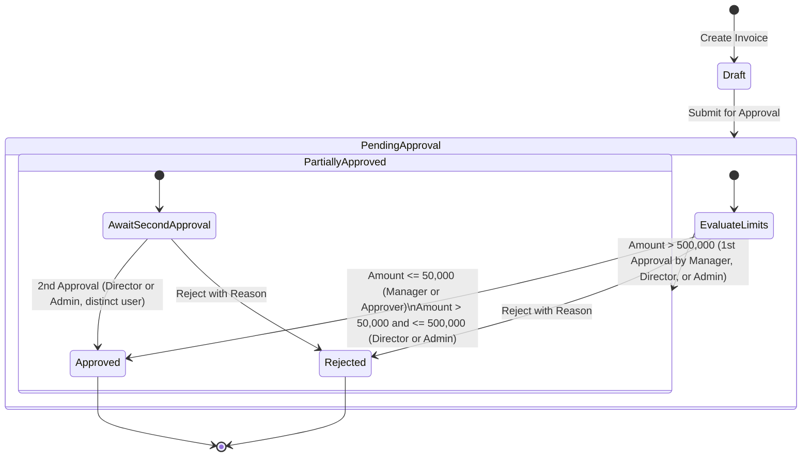

# Invoice Approval Demo App

#### Author: Adarsh Nishad

**Repository:** [AdarshN7/ai-sdlc-demo-app](https://github.com/AdarshN7/ai-sdlc-demo-app)
**Feature:** Role based approval limits and two approvers for high value invoices
**Stack:** Next.js 14 App Router, TypeScript, Vitest, Playwright, StrykerJS, OpenSpec

A full-stack invoice approval application built with **Next.js 14 App Router** and **TypeScript**, migrated from .NET 8 to demonstrate modern AI-in-SDLC practices. The application features **role-based approval limits** and a **dual-approver workflow for high-value invoices**, with business rules isolated in a pure domain layer. It includes unit, integration, and end-to-end tests, plus Stryker mutation testing.

## Demo Videos

- [SharePoint demo](https://nagarro-my.sharepoint.com/:v:/p/adarsh_nishad/IQB6jBdTbAQTR4h4ktDyaUFQAZwdRZHWrCDhOUTE--jP3Ek?nav=eyJyZWZlcnJhbEluZm8iOnsicmVmZXJyYWxBcHAiOiJTdHJlYW1XZWJBcHAiLCJyZWZlcnJhbFZpZXciOiJTaGFyZURpYWxvZy1MaW5rIiwicmVmZXJyYWxBcHBQbGF0Zm9ybSI6IldlYiIsInJlZmVycmFsTW9kZSI6InZpZXcifX0%3D&e=KUSdKP)
- [YouTube demo](https://youtu.be/zLCP96YUih0?si=QcW8l4_XqvpLx4ae)

---

## 🏗️ Project Architecture

The application is structured following Clean Layered Architecture, enforcing strict unidirectional dependencies from presentation down to a pure domain core:



### Architectural Principles

- **Pure Domain (`src/domain`)**: Free of React, Next.js, and HTTP dependencies. All business rules, boundary evaluations, and invariants execute as pure functions returning `{ ok: true, invoice }` or `{ ok: false, reason, message }`.
- **Validation First**: Preconditions and boundary limits are validated before any state mutation or repository write occurs. On rejection, entity state remains deeply equal to its pre-attempt state (**Atomic Immutability**).
- **Orchestration Only (`src/app/api`)**: Route Handlers authenticate requests, load entities, delegate to pure domain evaluators, save changes exclusively on success, and map domain errors to HTTP response codes.
- **In-Memory Singleton (`src/infrastructure`)**: Implemented on `globalThis.__invoiceRepository` to persist state across Next.js Hot Module Reloads (HMR) without requiring an external database.

Invoice data and sessions are held in memory and are lost when the server process restarts. The demo login credentials are for local demonstration only; this is not a production authentication or persistence design.

---

## 🔄 Invoice Approval Lifecycle



---

## ⚖️ The 5 Business Rules & Approval Limits

1. **Manager Approval Limit ($\le 50,000$)**:
   - `MANAGER_APPROVAL_LIMIT = 50_000` (inclusive).
   - Managers may approve invoices with amount $\le 50,000$.
   - Any attempt by a Manager to approve an amount $> 50,000$ is rejected with `LIMIT_EXCEEDED`.
2. **Director Approval Limit ($\le 500,000$)**:
   - `DIRECTOR_APPROVAL_LIMIT = 500_000` (inclusive).
   - Directors and Admins may sole-approve invoices with amount $\le 500,000$, transitioning directly from `PendingApproval` to `Approved`.
3. **High-Value Dual-Approver Rule ($> 500,000$)**:
   - Invoices strictly $> 500,000$ require **two distinct approvals**.
   - **First Approval**: Can be submitted by a Manager, Director, or Admin. The invoice transitions to `PartiallyApproved` and waits for a second approver. The base `Approver` role cannot approve invoices over $50,000.
   - **Second Approval**: Must be submitted by a different user with the **Director** or **Admin** role. The invoice transitions to `Approved`.
4. **Duplicate Approver Negative Rule (`SAME_APPROVER`)**:
   - The same individual cannot provide both approvals. Distinctness is validated strictly by unique user IDs (`user.id === priorApproval.userId`), never by display name or role.
5. **Non-Director Second Approver Negative Rule (`SECOND_APPROVER_NOT_DIRECTOR`) & Atomic Immutability**:
   - A user who is neither a Director nor an Admin attempting the second approval on a high-value invoice is rejected with `SECOND_APPROVER_NOT_DIRECTOR`.
   - On rejection, zero entity changes are persisted.

### Standardized Rejection Reason Codes

| Code                           | HTTP Status                | Description                                                                       |
| :----------------------------- | :------------------------- | :-------------------------------------------------------------------------------- |
| `LIMIT_EXCEEDED`               | `422 Unprocessable Entity` | Attempted approval amount exceeds the user's role maximum limit.                  |
| `SAME_APPROVER`                | `422 Unprocessable Entity` | Same user attempted to approve an invoice twice.                                  |
| `SECOND_APPROVER_NOT_DIRECTOR` | `422 Unprocessable Entity` | High-value second approval attempted by a user who is neither Director nor Admin. |
| `ROLE_NOT_ALLOWED`             | `422 Unprocessable Entity` | User's role is not permitted by the approval rules.                               |
| `INVOICE_NOT_PENDING`          | `409 Conflict`             | Invoice is not in `PendingApproval` or `PartiallyApproved` state.                 |

---

## 👥 Demo Accounts

The application includes predefined accounts for local testing (in-memory demo credentials):

| Username         | Password       | Role       | Description / Permissions                                                         |
| :--------------- | :------------- | :--------- | :-------------------------------------------------------------------------------- |
| `demo.manager`   | `ChangeMe123!` | `Manager`  | Approves invoices up to \$50,000; may provide the first approval above \$500,000. |
| `demo.director`  | `ChangeMe123!` | `Director` | Sole-approves up to \$500,000; may provide either approval above \$500,000.       |
| `demo.director1` | `ChangeMe123!` | `Director` | First Director account for dual-approval testing.                                 |
| `demo.director2` | `ChangeMe123!` | `Director` | Second Director account for distinct-approver testing.                            |
| `demo.approver`  | `ChangeMe123!` | `Approver` | Approves invoices up to \$50,000.                                                 |
| `demo.admin`     | `ChangeMe123!` | `Admin`    | May approve invoices and participate in either step of high-value approval.       |

---

## 🔌 API Routes

All endpoints except login require an `Authorization: Bearer <token>` header. `POST /api/auth/login` returns the token used by subsequent requests.

| Method   | Route                        | Access and behavior                                                        |
| :------- | :--------------------------- | :------------------------------------------------------------------------- |
| `POST`   | `/api/auth/login`            | Public; validates demo credentials and creates an in-memory session.       |
| `POST`   | `/api/auth/logout`           | Ends the bearer-token session.                                             |
| `GET`    | `/api/invoices`              | Lists invoices; optional `?status=Draft` status filter.                    |
| `POST`   | `/api/invoices`              | Creates an invoice from `customerName` and `amount`.                       |
| `GET`    | `/api/invoices/:id`          | Returns one invoice.                                                       |
| `DELETE` | `/api/invoices/:id`          | Admin only.                                                                |
| `POST`   | `/api/invoices/:id/submit`   | Submits a draft for approval.                                              |
| `POST`   | `/api/approvals/:id/approve` | Evaluates and records an approval when valid.                              |
| `POST`   | `/api/approvals/:id/reject`  | Rejects an invoice with a required `reason`.                               |
| `POST`   | `/api/test/reset`            | Resets demo invoices; hidden in production unless `ALLOW_TEST_RESET=true`. |

Approval rejections return HTTP 422 with `reason`, `error`, and `message` fields. Other common responses include 400 for invalid input, 401 for a missing or invalid session, 403 for role-based access denial, 404 for missing resources, and 409 for invalid state transitions.

---

## 📂 Project Directory Layout

```
ai-sdlc-demo-app/
├── src/
│   ├── app/                      # Next.js 14 App Router pages & API routes
│   │   ├── api/
│   │   │   ├── approvals/        # Approve & reject route handlers
│   │   │   ├── auth/             # Login & session handlers
│   │   │   ├── invoices/         # Invoice creation & query endpoints
│   │   │   └── test/reset/       # E2E test isolation reset endpoint
│   │   ├── globals.css           # Design tokens & styling
│   │   ├── layout.tsx            # Root layout
│   │   └── page.tsx              # Main dashboard UI
│   ├── domain/                   # Pure domain models, limits rules, pure evaluators
│   └── infrastructure/           # In-memory persistence, auth guards, HTTP error mapper
├── tests/
│   ├── unit/                     # Vitest unit tests (boundary limits, negative rules)
│   └── integration/              # Vitest route handler & HTTP error contract tests
├── e2e/                          # Playwright end-to-end tests and page objects
├── docs/                         # Assignment documentation, cold-vs-context, use cases
│   ├── use-cases/                # Use case briefs (bulk approval, partial approval)
│   └── cold-vs-context.md        # AGENTS.md efficacy analysis
├── openspec/                     # OpenSpec config and checked-in specifications
├── .agents/                      # AI agent workflows, skills, and execution hooks
├── .ai-sdlc/                     # Immutable AI interaction logs (interaction-log.jsonl)
├── AGENTS.md                     # Operational constitution & conventions for AI agents
└── ASSIGNMENT.md                 # Complete AI-SDLC assignment report & methodology
```

---

## 🚀 Getting Started

### Prerequisites

- Node.js 18.17+ or Node.js 20+
- npm 9+

### Installation & Run

```bash
# Install dependencies
npm install

# Start development server
npm run dev
```

Open [http://localhost:3000](http://localhost:3000) in your browser and sign in using any of the demo accounts listed above.

### Production build

```bash
npm run build
npm start
```

---

## 🧪 Testing & Quality Assurance

### 1. Unit & Integration Tests (Vitest)

Executes domain boundary tests, negative rules, deep equality checks, and API Route Handler integration:

```bash
npm test
```

Watch mode:

```bash
npm run test:watch
```

### 2. End-to-End Tests (Playwright)

Executes complete browser interactions verifying role switches, limits validation, and dual-approver workflows:

```bash
npm --prefix e2e run test:headed
```

### 3. Mutation Testing (StrykerJS)

Verifies test suite resilience by introducing artificial faults (mutants) into the domain evaluation logic:

```bash
npm run mutate
```

### 4. Code Quality & Linting

```bash
npm run lint
```

---

## 📖 Documentation & AI-SDLC Governance

- [ASSIGNMENT.md](ASSIGNMENT.md) – Full project delivery write-up, architectural trade-offs, and methodology.
- [AGENTS.md](AGENTS.md) – Project conventions, business rules, testing expectations, and review rubric.
- [docs/cold-vs-context.md](docs/cold-vs-context.md) – Comparative study of AI performance with and without contextual guidance.
- [openspec/](openspec/) – OpenSpec configuration and the approval change's proposal, design, delta specification, and task breakdown.
- [docs/use-cases/](docs/use-cases/) – Functional feature briefs.
